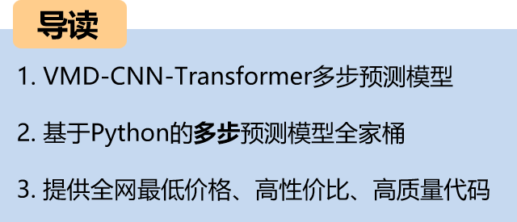
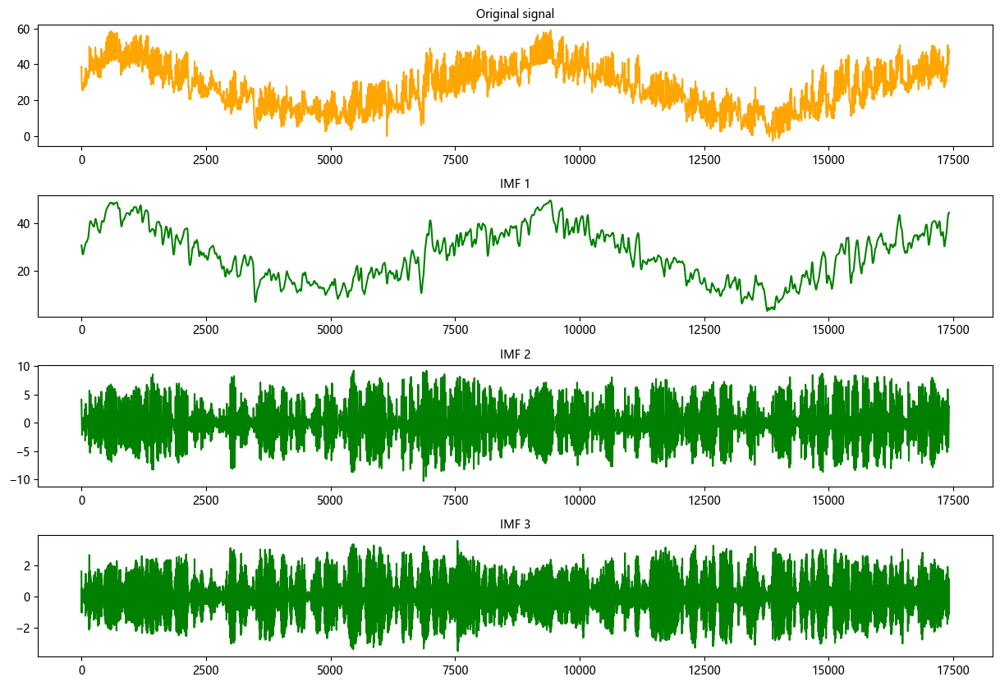
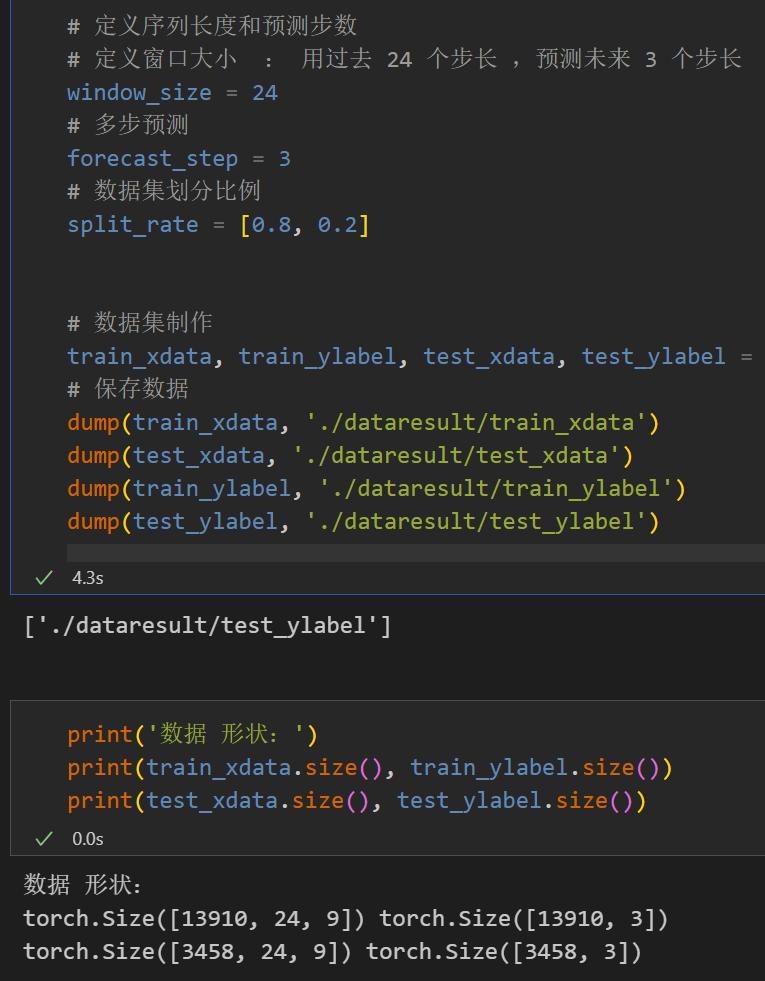
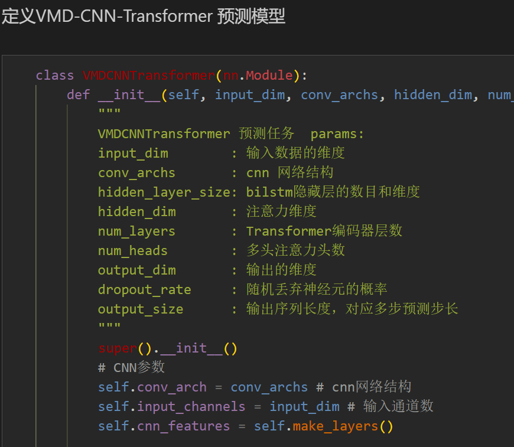
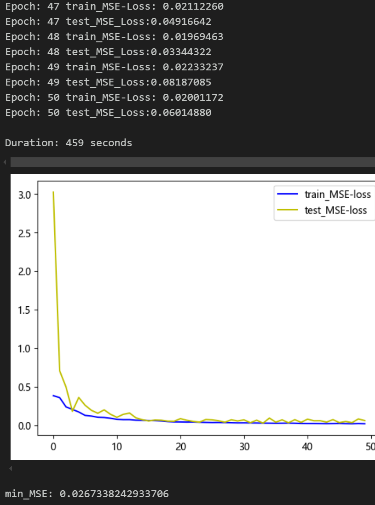
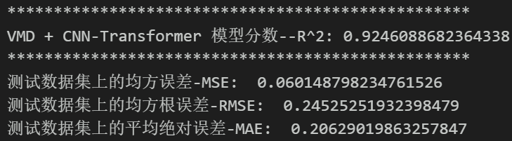
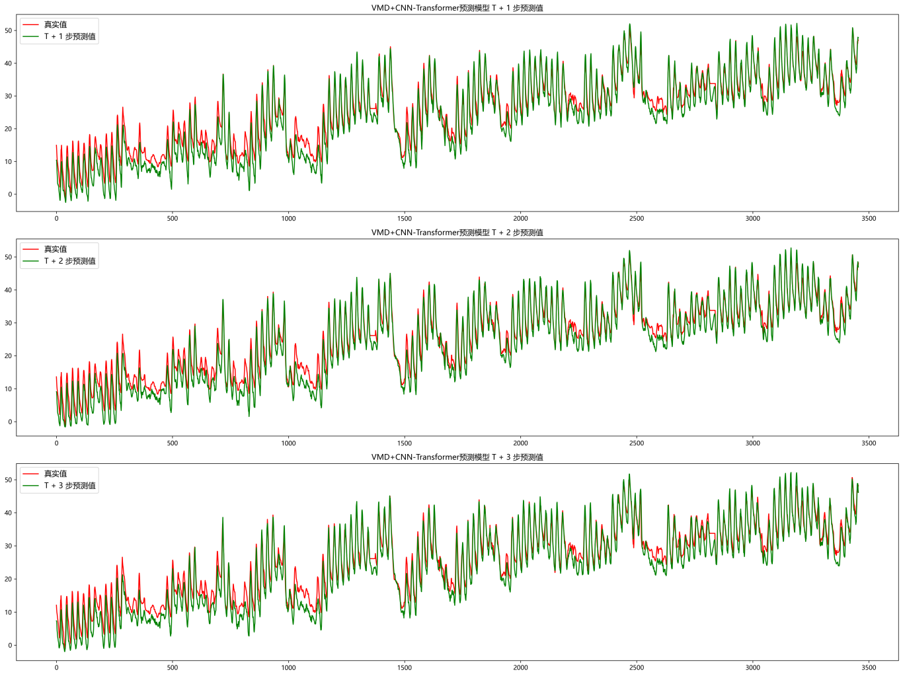
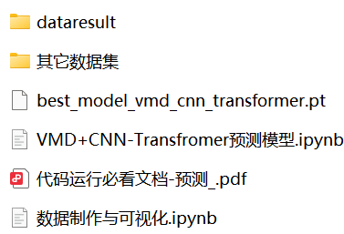

# Multi-step Prediction Model Based on VMD Decomposition + CNN-Transformer

\n        \n  
Multi-step predictive family set major update!!!
Preface
This article is based on the previously introduced power transformer (data set attached at the end of this document), introducing a multi-feature, multi-step prediction model based on the VMD-CNN-Transformer parallel network. For a detailed introduction to the power transformer dataset, please refer to the following text:
Introduction to the Power Transformer Dataset and Preprocessing
● Environment Framework: Python 3.9, PyTorch 2.1 and above can be run.
● Supplementary documents: detailed tutorials on environmental configuration and installation, as well as documentation on models and parameters.
● Usage Object: Paper requirements, graduation design requirements.
● Code Guarantee: The code comments are detailed and ready to run.
Including complete process data code processing:
Multi-step prediction dataset creation, data loading, model definition, parameter setting, model training, model testing, prediction visualization, model evaluation.
1 Data Preprocessing and Visualization of Electric Power Transformers
1.1 Import data
1.2 VMD Decomposition
\t  
\tMerge the decomposed components with other features to serve as input for model training!
\t1.3 Multi-step Preprocessing
2. Multi-step Prediction Model Based on VMD-CNN-Transformer
2.1 Define the CNN-Transformer parallel prediction network model
2.2 Set parameters and train the model
50 epochs, MSE is 0.0267, the VMD-CNN-Transformer multi-step prediction model has a significant predictive effect. The model can fully extract the spatiotemporal features of sequences, converges quickly, and exhibits superior performance with high accuracy in predictions, demonstrating good performance.
3 Results Visualization and Model Evaluation
3.1 Model Evaluation
\t  
3.2 Visualization of Prediction Results
Click to download: Complete original data and Python code  
Previously excellent content:  
Time series forecasting: Analysis and comparison of LSTM, ARIMA, Holt-Winters, SARIMA models  
Wind speed prediction (I) Data introduction and preprocessing  
Wind speed prediction (II) EMD-LSTM model based on Pytorch  
Wind speed prediction (III) EMD-LSTM-Attention model  
Wind speed prediction (IV) EMD-Transformer model based on Pytorch  
Wind speed prediction (V) EMD-CNN-LSTM model based on Pytorch  
Wind speed prediction (VI) EMD-CNN-GRU parallel model based on Pytorch  
CEEMDAN + combined forecasting model (BiLSTM-Attention + ARIMA)  
CEEMDAN + combined forecasting model (CNN-LSTM + ARIMA)  
CEEMDAN + combined forecasting model (Transformer - BiLSTM + ARIMA)  
CEEMDAN + combined forecasting model (CNN-Transformer + ARIMA)  
Multi-feature variable sequence prediction (I) - CNN-LSTM wind speed prediction model  
Multi-feature variable sequence prediction (II) - CNN-LSTM-Attention wind speed prediction model  
Multi-feature variable sequence prediction (III) - CNN-Transformer wind speed prediction model  
Multi-feature variable sequence prediction (IV) Transformer-BiLSTM wind speed prediction model  
Multi-feature variable sequence prediction (V) CEEMDAN+CNN-LSTM wind speed prediction model  
Multi-feature variable sequence prediction (VI) CEEMDAN+CNN-Transformer wind speed prediction model
Prediction Model Based on the Particle Swarm Optimization Algorithm SSA: CEEMDAN-BiLSTM-Attention
Prediction Model Based on the Particle Swarm Optimization Algorithm SSA: CEEMDAN-Transformer-BiGRU
Superior Prediction Model: Secondary Decomposition-Combination Prediction
Multi-Feature Variable Sequence Prediction (Part 7) CEEMDAN+Transformer-BiLSTM Prediction Model
Multi-Feature Variable Sequence Prediction (Part 8) CEEMDAN-SSA-BiLSTM Prediction Model Based on the Particle Swarm Optimization Algorithm
Multi-Feature Variable Sequence Prediction (Part 11) TCN-GRU Prediction Model Based on Pytorch
VMD + CEEMDAN Secondary Decomposition, CNN-LSTM Prediction Model
VMD + CEEMDAN Secondary Decomposition, CNN-Transformer Prediction Model
VMD + CEEMDAN Secondary Decomposition, Transformer-BiGRU Prediction Model
Prediction Model Based on the Particle Swarm Optimization Algorithm SSA: Code All-in-One Kit
Introduction to the Power Transformer Data Set and Preprocessing
 | Sci-Tech 1st Class High Innovation Prediction Model!
END

## Images

<!-- PAYMENT_BLOCK -->

## Get this dataset

- Payment link (Stripe): [Buy now](https://buy.stripe.com/3cs8yP7sY87d0vu9AB)
- Payment QR code: 

<!-- /PAYMENT_BLOCK -->
